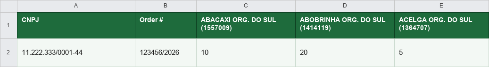

# order-pdf-to-excel

Turns a supplier's PDF purchase orders into a spreadsheet ready for harvest planning.

## The problem

Orders arrive as PDFs, one per store, sometimes several stores bundled into a single file. Before this tool, someone had to open each PDF, read every line item, and type the quantities into a spreadsheet by hand to figure out what to harvest and pack. On a busy day that means going through dozens of orders line by line, and a mistyped quantity means picking the wrong amount of produce.

## The solution

The tool reads the PDF, pulls out each order's CNPJ, order number and product lines, and writes the quantities straight into the matching row and column of an existing planning spreadsheet.

```
order.pdf
    |
    v
pdfplumber extracts the text, page by page
    |
    v
regex finds the order number, the buyer's CNPJ and each product line
    |
    v
SEQ codes are matched against the product catalog (products.py)
    |
    v
openpyxl writes the quantities into the row for that CNPJ
    |
    v
order_updated.xlsx
```

A PDF can contain more than one purchase order (one per store); the tool splits them by order number and CNPJ and updates every matching row in the spreadsheet.

## Features

- Reads single or multi-order PDFs and extracts order number, buyer CNPJ, store name and product quantities.
- Matches products by their SEQ code against a maintained catalog, so a truncated or oddly wrapped name in the PDF doesn't break the match.
- Parses quantities and prices in both Brazilian (`1.234,56`) and US (`1,234.56`) number formats.
- Warns about SEQ codes found in a PDF that aren't in the catalog yet, instead of silently dropping them.
- Flags CNPJs that show up in the PDF but have no row in the spreadsheet, instead of writing to the wrong place.
- Simple Tkinter GUI: pick a PDF and a spreadsheet, click process.
- Ships as a single Windows executable via PyInstaller, no Python install needed to run it.

## Tech stack

- Python 3.11
- [pdfplumber](https://github.com/jsvine/pdfplumber) for PDF text extraction
- [openpyxl](https://openpyxl.readthedocs.io/) for reading and writing the spreadsheet
- Tkinter for the GUI
- [PyInstaller](https://pyinstaller.org/) for the standalone executable
- [python-dotenv](https://github.com/theskumar/python-dotenv) for loading the buyer/seller config from a `.env` file

## How to run

### From source

```powershell
python -m venv .venv
.venv\Scripts\activate
pip install -r requirements.txt
python main.py
```

Copy `.env.example` to `.env` and fill in `SELLER_CNPJ` (your own company's CNPJ, excluded when scanning for the buyer) and `BUYER_COMPANY_MARKER` (the text that precedes the buyer's CNPJ in your PDFs). Without a `.env` file the tool falls back to the placeholders used in `examples/`.

### Building the executable

```powershell
pip install -r requirements.txt
.\build.ps1
```

This runs PyInstaller against `order-pdf-to-excel.spec` and produces `dist/order-pdf-to-excel.exe`.

## Example

`examples/` has a fictional order and spreadsheet, generated by `examples/generate_examples.py` and run through the actual pipeline:

- `order_example.pdf`: a made-up purchase order (fake CNPJ, fake store, three products).
- `order_template.xlsx`: the planning spreadsheet before processing, with one row for the buyer's CNPJ and one column per product SEQ.
- `order_updated.xlsx`: the same spreadsheet after running the tool against the PDF above.

Resulting row:



## Impact

- Cut order processing from about **60 to 80 minutes** to roughly **2 minutes** per day, saving roughly **5 to 6 hours** of manual data entry.
- Removed typing mistakes in quantities, which used to mean harvesting and packing the wrong amount of produce.

## What I'd improve next

- Extraction currently depends on a fixed regex per line, which breaks if a client changes their PDF layout. A more robust version would use an LLM to parse the line items, with the regex path as a fast fallback.
- A graphical interface with drag-and-drop and a preview of what will be written, instead of the current pick-a-file dialog.
- Automated tests covering different PDF layouts instead of the manual `examples/generate_examples.py` check.

---

Built by Vinicius Gouvea to automate order processing at Hidrocenter and others.
